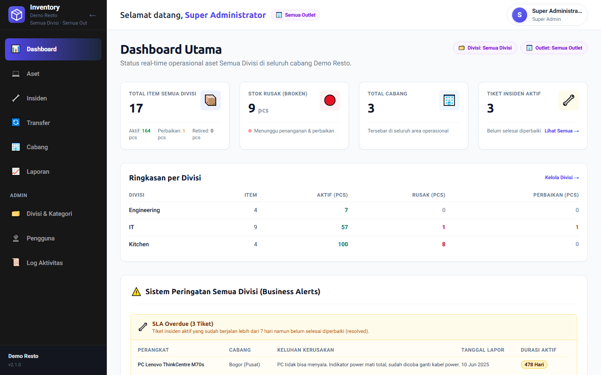
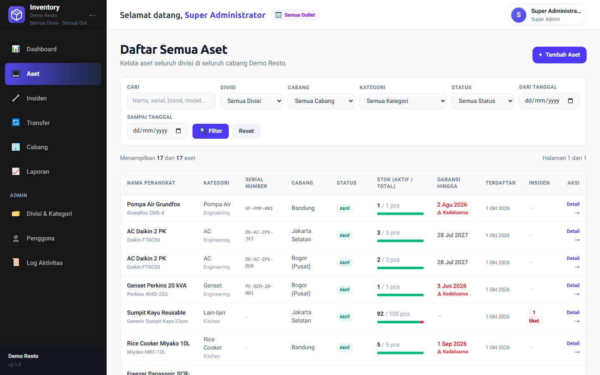
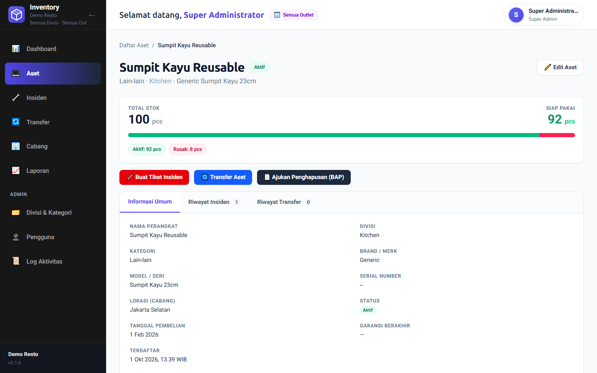
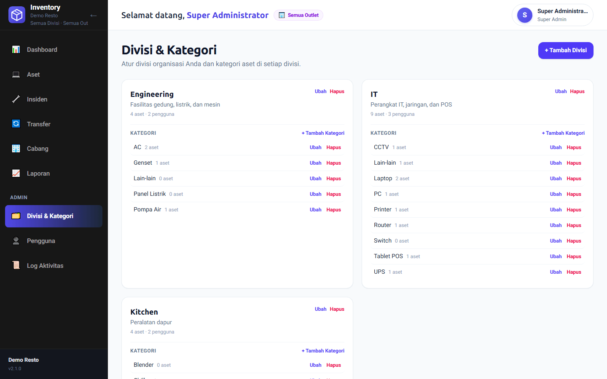
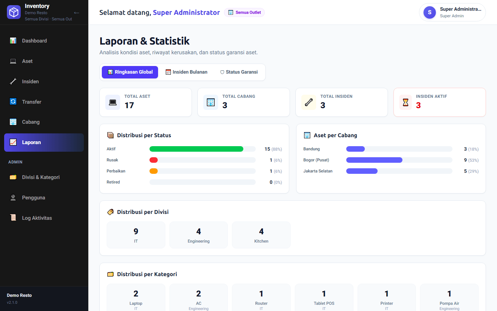
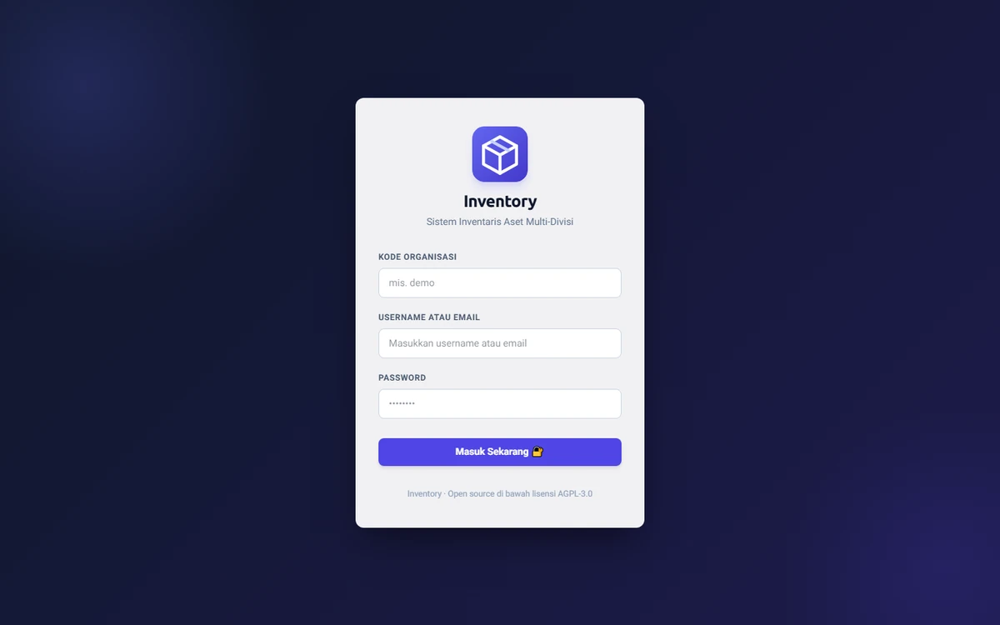
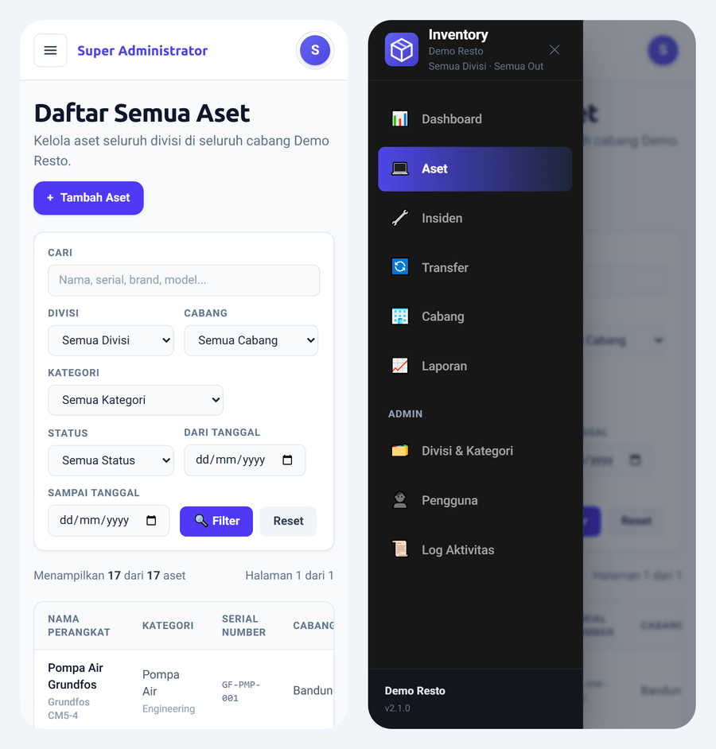

<!-- Keep synchronized with the English sections of README.md. -->
<div align="center">


# Inventory

**Open-source asset & inventory management for organizations with many divisions and outlets.**

[English README](README.en.md) · [Bahasa Indonesia](README.md#ringkasan-bahasa-indonesia)

Track every item by condition, move stock between outlets with approvals, write off assets with a documented report, and handle damage tickets — all scoped per organization, division, and outlet.

[](LICENSE)
[](https://github.com/MotionFrog13/Inventory/actions/workflows/ci.yml)


[Features](#features) · [Screenshots](#screenshots) · [Quick start](#quick-start) · [Languages](#interface-languages) · [Configuration](#configuration) · [Backups](#backups-and-recovery) · [Troubleshooting](#troubleshooting) · [Roadmap](#roadmap)

</div>



> [!NOTE]
> **Project status: early but working.** The core (multi-tenant isolation, roles, stock, transfers, write-offs, incidents) is implemented and covered by automated tests. It is ready for **self-hosted, single-organization** use. **English is the default interface language**, with **Bahasa Indonesia** available from the language selector on the login page and application header. Please read [Security notes](#security-notes) before exposing an instance to the internet.

## Features

- **Multi-tenant by design** — every row belongs to an organization. Isolation is enforced twice: a tenant-bound Prisma client injects the organization into every query, and composite foreign keys `(organizationId, …)` make the database itself reject cross-tenant references. Another organization's data simply answers `404`.
- **Dynamic divisions & categories** — create divisions such as IT, Kitchen, Engineering, or Housekeeping, each with its own asset categories. No hard-coded asset types.
- **Three role tiers** — Super Admin, Division Admin, and Division Staff. Labels follow the division ("Kitchen Admin", "IT Staff" in English). Division admins and staff can be assigned to **several outlets** and must have both a division and at least one outlet before they can access inventory.
- **Stock by condition** — one item can hold many pieces split into *active*, *broken*, *in repair*, *retired*, and *reserved* buckets. The item status is derived from the buckets, so 92 working + 8 broken chopsticks still show as active.
- **Outlet transfers** — request a move to another outlet; an admin of the **origin** outlet or a Super Admin can approve, and the move is applied in a single database transaction.
- **Write-offs with evidence (BAP)** — submit a disposal report with a PDF or photo (images are compressed server-side to WebP). Documents are stored outside the web root and only open for users who can see the asset. Only the submitted pieces are reserved, the rest stays usable; approval removes them for good, rejection returns them to their original bucket.
- **Incident tickets** — report broken pieces, let staff propose a fix, and let admins approve or resolve directly. The chosen outcome decides where the pieces go (active, repair, retired).
- **Reports & alerts** — per-division and per-category distribution, monthly incident trends, warranty expiry, and SLA-overdue tickets on the dashboard.
- **Activity log** — automatic, read-only audit trail visible to the Super Admin of each organization.
- **Responsive** — works on phones, with an off-canvas navigation drawer.
- **English & Indonesian** — English on first visit; change language on the login page or header. Your choice persists across pages, refreshes, and sign-ins. Dates follow the selected language and retain the Asia/Jakarta time zone; your own asset and organization data stays unchanged.
- **Self-host on your own computer** — one Docker container (PostgreSQL included) started with a double-click, for development or production. Make it reachable over HTTPS with the built-in Cloudflare Tunnel, without a VPS or router port forwarding.

## Screenshots

| Assets | Asset detail with stock by condition |
|---|---|
|  |  |
| **Divisions & categories** | **Reports** |
|  |  |
| **Login (SaaS mode)** | **Mobile** |
|  |  |

## Tech stack

- [Next.js 16](https://nextjs.org/) (App Router) & [React 19](https://react.dev/), TypeScript
- [Prisma 7](https://www.prisma.io/) with `@prisma/adapter-pg` and a tenant-bound client extension
- PostgreSQL 15+
- [Tailwind CSS v4](https://tailwindcss.com/)
- JWT sessions in HTTP-only cookies, bcrypt password hashing
- [sharp](https://sharp.pixelplumbing.com/) for server-side image compression
- Tests: `node:test` (unit & integration) and an HTTP QA runner
- Docker: one container with Node.js 24 + PostgreSQL 15, optional [Cloudflare Tunnel](https://developers.cloudflare.com/cloudflare-one/connections/connect-networks/) (`cloudflared`)

## Quick start

### Install for everyday use — Docker only

Install and start Docker Desktop (Windows/macOS), or Docker Engine with Compose **2.20+** (Linux). Internet is needed for the initial image build; local use afterwards does not need Google Fonts or a cloud account. No local Node.js, PostgreSQL, `.env`, or manual migration is required.

Download and extract the [source ZIP](https://github.com/MotionFrog13/Inventory/archive/refs/heads/master.zip), then double-click **`docker-prod.bat`** on Windows. On macOS/Linux, run `bash docker/launch.sh prod` in the extracted folder. The launcher builds the image, starts the app and database, shows the generated admin password, and opens the browser.

With Git and a terminal, the equivalent installation is:

```bash
git clone https://github.com/MotionFrog13/Inventory.git
cd Inventory
docker compose up -d --build --wait --wait-timeout 600
docker compose logs app
```

Open **http://localhost:8000**. Sign in as **`superadmin`**, using the random password marked **`Password Super Admin pertama`** (first Super Admin password) in the logs. Change it in **Users**, then create your divisions, categories, outlets and users. Production starts with one organization and one admin, with no demo assets. The first build can take several minutes depending on your connection and computer; wait for the container to become healthy.

After signing in for the first time:

1. Open **Users** and change the initial admin password.
2. Open **Divisions & categories**, create your divisions, and add their asset categories.
3. Open **Outlet** and add your operational locations.
4. Create accounts in **Users**. Assign each Division Admin or Division Staff member a division and at least one outlet.
5. Open **Assets** and add your first inventory items.

Subsequent starts keep the same accounts, database, uploads and secrets in the `inventory_data` volume. Do not delete this volume or use `down -v` on a real installation. [Installation guide (Bahasa Indonesia)](INSTALL.md) · [Docker, backups and HTTPS](docs/docker.md).

| Task | Command |
|---|---|
| Start again | `docker compose up -d --wait --wait-timeout 600` |
| Stop (keep data) | `docker compose down` |
| Check status / logs | `docker compose ps` / `docker compose logs --tail 100 app` |
| Update (back up first) | `git pull --ff-only`, then `docker compose up -d --build --wait --wait-timeout 600` |

If port 8000 is busy, copy `docker/.env.example` to `docker/.env`, set `PROD_PORT=8001`, and start again at http://localhost:8001. To choose your organization and admin details, edit that file **before the first start**. These bootstrap settings do not rename an existing organization or reset its password.

### Docker development and public access

PostgreSQL and the app run together in a single container; only Docker is required.

| | Development | Production | Production + public URL |
|---|---|---|---|
| Windows (double-click) | `docker-dev.bat` | `docker-prod.bat` | `docker-tunnel.bat` |
| macOS / Linux | `bash docker/launch.sh dev` | `bash docker/launch.sh prod` | `bash docker/launch.sh prod tunnel` |
| URL | http://localhost:3000 | http://localhost:8000 | a temporary `https://<random>.trycloudflare.com`, or your own domain |
| What runs | `next dev` on your working copy, hot reload, demo data | `next build` + `next start`, one organization and a Super Admin whose random password is printed in the container log | the production container plus Cloudflare Tunnel |

Secrets (JWT, database password) are generated on first start and kept in a Docker volume. See [docs/docker.md](docs/docker.md) (Bahasa Indonesia) for settings, backups, and HTTPS.

**Public access from your own computer.** Production mode can be published over HTTPS with Cloudflare Tunnel, built into the container, without a VPS, public IP, or router port forwarding. `docker-tunnel.bat` needs no account and gives a temporary address that changes on every restart, which suits trials. For daily use, create a tunnel in Cloudflare Zero Trust for your own domain and put its token in `docker/.env` (`CLOUDFLARE_TUNNEL_TOKEN`); `docker-prod.bat` then starts it automatically. Your computer has to stay on, and the login page becomes reachable from the internet — read [Security notes](#security-notes) first.

### Manual setup for development

**Requirements:** Node.js 20.19+, 22.12+ or 24+ · PostgreSQL 15+ (or Docker)

```bash
git clone https://github.com/MotionFrog13/Inventory.git
cd Inventory
npm ci
cp .env.example .env          # then set JWT_SECRET to a long random string
docker compose -f docker/compose.db.yml up -d --wait # optional: local PostgreSQL
npx prisma migrate deploy     # create the schema
npx prisma db seed            # demo data — WIPES the whole database
npm run dev
```

Open http://localhost:3000 and sign in with a demo account:

| Username | Password | Role | Division | Outlets |
|---|---|---|---|---|
| `superadmin` (or `superadmin@demo.local`) | `admin123` | Super Admin | all | all |
| `admin_it` | `admin123` | Division Admin | IT | Bogor |
| `staff_it` | `staff123` | Division Staff | IT | Bogor |
| `admin_kitchen` | `admin123` | Division Admin | Kitchen | Bogor |
| `teknisi_engineering` | `staff123` | Division Staff | Engineering | Bogor + Jakarta Selatan |

In `saas` mode, enter the organization code **`demo`** together with a username (or just use an email address). The full list of demo accounts, plus step-by-step scenarios, is in [get-started.md](get-started.md) (Bahasa Indonesia).

> [!WARNING]
> The demo passwords are for development only. `npx prisma db seed` deletes **all** data and refuses to run with `NODE_ENV=production` unless `ALLOW_DESTRUCTIVE_SEED=true` is set.

## Configuration

All settings live in `.env` (see [`.env.example`](.env.example)). The Docker setup reads `docker/.env` instead and generates its own secrets — see [`docker/.env.example`](docker/.env.example) and [docs/docker.md](docs/docker.md).

### Docker settings

These settings are optional. Copy `docker/.env.example` to `docker/.env` before changing them.

| Variable | Default | Purpose |
|---|---|---|
| `PROD_PORT` | `8000` | Port used to open the production app on your computer |
| `PROD_APP_MODE` | `self-hosted` | Production login and organization mode |
| `ORG_NAME` / `ORG_SLUG` | `Organisasi Saya` / `main` | Initial organization name and code |
| `ADMIN_NAME` / `ADMIN_USERNAME` | `Super Administrator` / `superadmin` | Initial admin name and username |
| `ADMIN_EMAIL` | `admin@inventory.local` | Initial admin email; set this to your own address |
| `ADMIN_PASSWORD` | generated randomly | Initial admin password; at least 8 characters if supplied |
| `DEV_PORT` / `DEV_DB_PORT` | `3000` / `55432` | Development app and local database ports |
| `DEV_APP_MODE` | `self-hosted` | Set to `saas` when running the HTTP QA suites |
| `CLOUDFLARE_TUNNEL_TOKEN` | empty | Optional token for a tunnel with your own domain |

Organization and admin bootstrap settings apply only to an empty database. Changing them later does not reset an existing account or rename its organization. The default organization name, `Organisasi Saya`, means "My Organization"; choose a name before first start with `ORG_NAME`.

### Manual installation settings

| Variable | Required | Description |
|---|---|---|
| `DATABASE_URL` | yes | PostgreSQL connection string |
| `JWT_SECRET` | yes | Secret used to sign session tokens — use a long random value |
| `JWT_EXPIRES_IN` | no | Session lifetime, default `8h` |
| `APP_MODE` | no | `self-hosted` (default) or `saas` |
| `ALLOW_DESTRUCTIVE_SEED` | no | Allow the demo seed to wipe a database when `NODE_ENV=production` |
| `UPLOAD_DIR` | no | Where write-off documents are stored, default `uploads/` in the project folder |

### Deployment modes

| | `self-hosted` (default) | `saas` (experimental) |
|---|---|---|
| Organizations | exactly one — login is refused (`503`) if the database holds more or fewer | many |
| Login | username or email + password | email + password, **or** organization code + username + password |
| Extras | — | `/login?org=demo` pre-fills the organization code |

## Interface languages

**English is the default.** Choose **English** or **Bahasa Indonesia** using the language selector on the sign-in page or application header. The preference persists across navigation, page refreshes, and sign-ins.

Navigation, forms, status labels, validation messages, reports, and dates follow the selected language. Dates use the **Asia/Jakarta** time zone in both languages. Names, notes, descriptions, and other data entered by your team remain as written.

Translation contributors can find the dictionary and implementation guide in [docs/localization.md](docs/localization.md). Some existing screenshots show the Indonesian interface.

## Backups and recovery

Production data lives in the Docker volume **`inventory_data`**: PostgreSQL data, uploaded write-off documents, and generated secrets. Rebuilding or recreating the container keeps this volume. Back up before updating the application.

From the project folder, save a SQL dump and a copy of the uploaded documents:

```bash
docker compose exec -T app gosu postgres pg_dump inventory > backup-inventory.sql
docker compose cp app:/data/uploads ./backup-uploads
```

Use Bash or Command Prompt for the SQL redirection above. If you normally use PowerShell, run the dump command in Command Prompt to avoid encoding differences. Store backups privately because they contain organization data and password hashes.

Restore onto a separate installation with an empty database, using the same application version as the backup. Keep the original installation available until you verify the restored accounts and documents.

<details>
<summary>Restore a backup to a replacement installation</summary>

Start the replacement installation first, and keep it unavailable to other users while restoring. Copy the backup files into its project folder, then run these commands there. **The SQL command replaces the destination database's contents.**

```bash
docker compose cp ./backup-inventory.sql app:/tmp/restore.sql
docker compose exec -T app gosu postgres psql -d inventory -v ON_ERROR_STOP=1 -c "DROP SCHEMA public CASCADE; CREATE SCHEMA public;" -f /tmp/restore.sql
docker compose cp ./backup-uploads/. app:/data/uploads/
docker compose exec -T app chown -R node:node /data/uploads
docker compose restart app
```

Sign in with an account from the backup, verify inventory and write-off documents, then remove the temporary SQL file:

```bash
docker compose exec -T app rm /tmp/restore.sql
```

Newly generated JWT secrets require users to sign in again. The restored password hashes keep the original account passwords. More operational details are available in [the Docker guide](docs/docker.md#7-data--backup) (Bahasa Indonesia).

</details>

**Do not use `docker compose down -v` on a real installation:** it removes the persistent volume. Normal `docker compose down` stops the application while retaining data.

## Troubleshooting

| Problem | What to check |
|---|---|
| Docker is unavailable | Start Docker Desktop and wait for the engine to be ready. On Linux, check that Docker Engine and Compose are installed and running. |
| Compose rejects `include` | Upgrade to Compose 2.20+ or use `docker-prod.bat` / `bash docker/launch.sh prod`, which selects the production configuration directly. |
| Port 8000 is already in use | Set `PROD_PORT=8001` in `docker/.env`, start again, and open `http://localhost:8001`. |
| The first build is slow or a download fails | Check access to the Docker and npm registries, then retry. Fonts are bundled locally. |
| The application does not become healthy | Run `docker compose ps` and `docker compose logs --tail 100 app`. Keep the data volume while investigating. |
| The initial admin password was missed | Check `docker compose logs app` before recreating the container. The password is printed only during initial bootstrap. |
| Changing `ADMIN_PASSWORD` has no effect | It only configures the first admin on an empty database. Change an existing account's password through **Users**. |
| Login fails using a LAN IP address | Production sessions use Secure cookies. Use HTTPS for other devices; use `http://localhost:8000` on the host computer. |
| A division user cannot access inventory | Assign both a division and at least one outlet in **Users**. |
| An older installation's data is missing | The separate developer database uses `docker/compose.db.yml`; production uses a different volume. Plan a backup and migration before switching setups. |

## Roles

| Action | Super Admin | Division Admin | Division Staff |
|---|---|---|---|
| View assets, incidents, write-offs, transfers | whole organization | own division in own outlets | own division in own outlets |
| Create / edit assets | ✓ | ✓ | — |
| Report incidents, request transfers & write-offs | ✓ | ✓ | ✓ |
| Approve write-offs & incident resolutions | ✓ | ✓ (own division) | — |
| Approve transfers | ✓ | ✓ (origin outlet) | — |
| Manage categories | ✓ | ✓ (own division) | — |
| Manage divisions, outlets, users; activity log | ✓ | — | — |

## Testing

```bash
npm run typecheck && npm run lint && npm run build
npm run test:unit            # pure functions (scope rules, validation)
npm run test:integration     # tenant isolation against the development database
npm run qa                   # HTTP scenarios — needs `npm run dev` and APP_MODE="saas"
npm run test:install         # isolated production Docker install + persistence smoke test
QA_ONLY=transfers npm run qa # a single suite
```

The full test catalogue and the architecture rules contributors must follow are in [CLAUDE.md](CLAUDE.md) (Bahasa Indonesia) and [AGENTS.md](AGENTS.md) (English).

## Project structure

```
prisma/            schema, migrations, demo seed (+ production bootstrap mode)
src/app/           pages (App Router) and API routes (src/app/api)
src/components/    shared UI (shell, sidebar, header, access denied)
src/lib/           auth & request context, scope rules, tenant client, stock & upload helpers
qa/, tests/        HTTP QA suites, unit and integration tests
docker/            single-container entrypoint, compose files (dev/prod), launchers
docs/              Docker guide, design spec, implementation plan, screenshots
uploads/           write-off documents (created at runtime, not in git)
Dockerfile         image targets `dev` and `prod`
docker-*.bat       one-click launchers for Windows (dev, prod, tunnel)
```

## Security notes

Known limitations of the current release — see [SECURITY.md](SECURITY.md) for how to report a vulnerability:

- Login is throttled per process (10 attempts per login identifier in 15 minutes and 120 attempts overall per minute). Counters reset on restart and are not shared between instances; username and email aliases have separate counters. Use HTTPS and an edge/shared rate limiter for production — with Cloudflare Tunnel, add a Cloudflare rate limiting rule for `/api/auth/login` or protect the site with Cloudflare Access. Password reset and email verification are not implemented yet.
- `saas` mode has no public sign-up and is **not** ready for hosting untrusted organizations.

## Roadmap

1. ✅ **Foundation** — organizations, dynamic divisions & categories, three role tiers, multi-outlet users, tenant-bound database client.
2. **Cross-division repair tickets** — route a category's tickets to a handling division (e.g. Engineering), assign technicians, track progress and SLA.
3. **Open-source readiness** — ✅ automatic production bootstrap, login rate limiting, and English & Indonesian UI; setup wizard and configurable name/logo/time zone still planned.
4. **Distribution** — ✅ single-container Docker installation, CI, clean-install testing, backup guide and built-in Cloudflare Tunnel ([docs/docker.md](docs/docker.md)); a published image is still planned.
5. **SaaS** — public sign-up, email verification & password reset, quotas, platform admin.

Mobile device management (MDM) is disabled until it is redesigned per division.

## Contributing

Contributions are welcome — please read [CONTRIBUTING.md](CONTRIBUTING.md) first. Changes to [CHANGELOG.md](CHANGELOG.md) are expected for user-facing work.

## About

Inventory grew out of the day-to-day needs of a multi-outlet food & beverage business: laptops and CCTV live next to chillers and stoves, every outlet has its own team, and nothing should move or disappear without someone signing off. The project is now a general-purpose, open-source system for any organization that manages physical assets across divisions and locations — restaurants, retail chains, hotels, schools, or offices.

Maintained by [@MotionFrog13](https://github.com/MotionFrog13) and contributors.

## License

Inventory is free software, licensed under the [GNU Affero General Public License v3.0 or later](LICENSE). You may use, modify, and self-host it freely; if you offer a modified version to users over a network, you must make your source code available to them under the same license.
